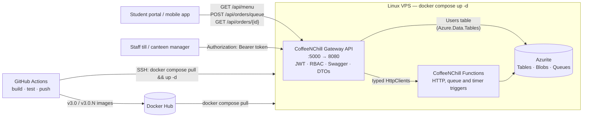
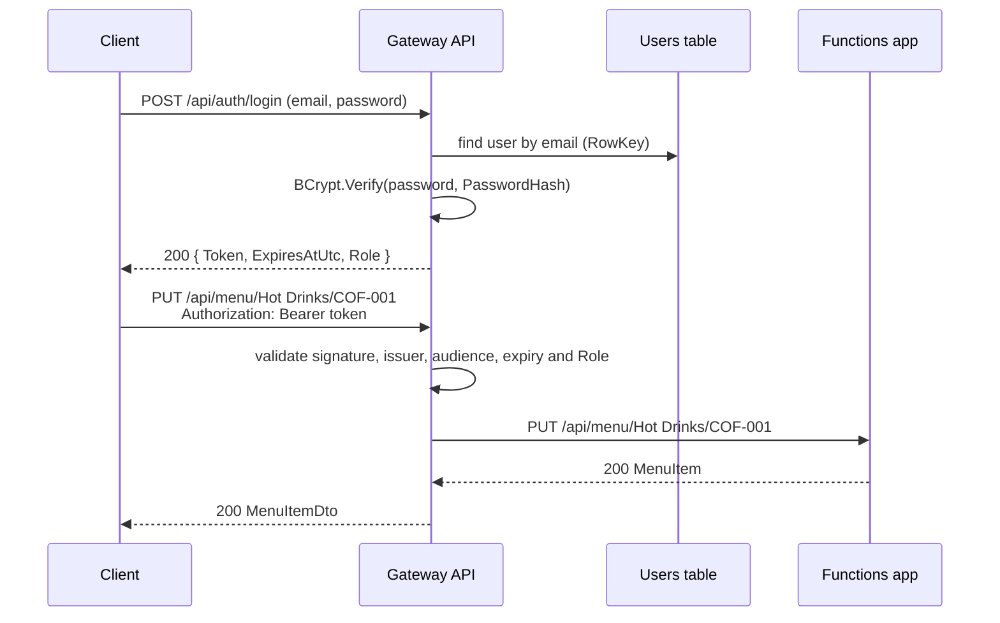

# CoffeeNChill — Canteen Management System

**Part 3 (POE) — Web API Gateway, JWT Authentication & VPS Deployment**

CoffeeNChill is a campus canteen. Part 1 replaced the paper menus and filing-cabinet documents with Azure Table Storage, Azure Blob Storage and HTTP-triggered Azure Functions. Part 2 handled the lecture-break rush with an order queue, queue-triggered processing and Docker Compose. Part 3 puts one secure front door in front of everything:

- **ASP.NET Core Web API gateway** (`CoffeeNChillGatewayAPI`) that routes every client request to the Azure Functions, using DTOs so storage details never leak to clients.
- **JWT bearer authentication** with user profiles in a **Users** Azure Table and passwords hashed with **BCrypt**.
- **Role-based access control**: students can view the menu, place orders and track them without logging in. Only **Admin** and **Staff** users can change the menu, manage staff documents and update order statuses.
- **Swagger / OpenAPI UI** with XML documentation for every endpoint, request body and response code, plus an **Authorize** button for the bearer token.
- **Global exception middleware** that turns every failure into the same JSON error body.
- **Live Linux VPS deployment** with Docker Compose pulling the published images from Docker Hub.
- **GitHub Actions CI/CD pipeline** (bonus) that builds, runs the unit tests, pushes version-tagged images and redeploys the VPS on every push to `main`.

> **Live gateway (VPS):** `http://<VPS-IP>:5000/swagger` — _replace with the public address of the VPS before submitting._

---

## Architecture



| Layer | What it does |
|---|---|
| **Gateway API** | The only service exposed to the internet (port `5000`). Validates DTOs, checks the JWT and role, then calls the Functions app through typed `HttpClient`s (`MenuFunctionClient`, `DocumentFunctionClient`, `OrderFunctionClient`). Reads and writes the `Users` table directly with the Azure Tables SDK. |
| **Functions app** | Unchanged Part 2 logic for the menu, documents, order queue, order lifecycle and poison queue, plus two new HTTP triggers: `DeleteStaffDocument` and `UpdateOrderStatus`. Only reachable on the Docker network (bound to `127.0.0.1:7071` on the host). |
| **Azurite** | Tables (`MenuItems`, `Orders`, `FailedOrders`, `Users`), the `staff-docs` blob container and the `order-processing-queue` queue. Bound to `127.0.0.1`, so the storage ports are never public on the VPS. |

### How a protected request flows



A missing, expired or tampered token gets `401 Unauthorized`. A valid token without the right role gets `403 Forbidden`.

---

## Project structure

```
CoffeeNChill/
├── .github/workflows/deploy.yml               CI/CD pipeline (bonus)
├── .env.example                               VPS secrets template (copy to .env)
├── CoffeeNChill.slnx
├── docker-compose.yml                         Azurite + Functions + Gateway from Docker Hub
├── README.md
├── docs/
│   ├── CoffeeNChill.postman_collection.json   Part 3 collection (through the gateway)
│   ├── CoffeeNChill-Part2-Functions.postman_collection.json
│   ├── sample-recipe.pdf                      upload test file
│   └── sample-menu.csv                        unsupported-type test file
├── CoffeeNChillExample/                       Azure Functions app (v3.0)
│   ├── Dockerfile
│   ├── Functions/   (17 functions, incl. new DeleteStaffDocument and UpdateOrderStatus)
│   ├── Models/      (incl. new OrderStatusUpdate)
│   └── Services/
├── CoffeeNChillGatewayAPI/                    ASP.NET Core Web API gateway (new)
│   ├── Dockerfile
│   ├── Program.cs
│   ├── appsettings.json / appsettings.Development.json
│   ├── Clients/        FunctionClientBase, MenuFunctionClient, DocumentFunctionClient, OrderFunctionClient
│   ├── Configuration/  JwtSettings, FunctionsSettings, SeedAdminSettings
│   ├── Constants/      Roles
│   ├── Controllers/    AuthController, MenuController, DocumentsController, OrdersController
│   ├── DTOs/           AuthDtos, MenuDtos, OrderDtos, DocumentDtos, ErrorResponseDto
│   ├── Exceptions/     FunctionsApiException
│   ├── Mappers/        MenuItemMapper, OrderMapper, DocumentMapper
│   ├── Middleware/     GlobalExceptionMiddleware, ErrorResponseWriter
│   ├── Models/         UserEntity and the Function response models
│   ├── Services/       AuthService, TokenService, UserService
│   └── Swagger/        AuthorizeOperationFilter, AcceptsBearerTokenAttribute
└── CoffeeNChillGatewayAPI.Tests/              xUnit tests run by the pipeline
```

---

## API Endpoints (Gateway)

Base URL: `http://localhost:5000/api` locally, or `http://<VPS-IP>:5000/api` on the VPS. Swagger UI is at `/swagger`.

### Authentication

| Method | Route | Access | Description |
|---|---|---|---|
| POST | `/api/auth/register` | Anonymous (Customer) / **Admin** (Staff, Admin) | Hashes the password with BCrypt and adds the user to the `Users` table |
| POST | `/api/auth/login` | Anonymous | Checks the credentials and returns a signed JWT |
| GET | `/api/auth/me` | Any logged-in user | Returns the claims inside the token |

### Menu

| Method | Route | Access | Description |
|---|---|---|---|
| GET | `/api/menu` | **Anonymous** | All menu items |
| GET | `/api/menu/category/{category}` | **Anonymous** | Menu items in one category |
| POST | `/api/menu` | Admin, Staff | Add a menu item |
| PUT | `/api/menu/{category}/{id}` | Admin, Staff | Change price, availability, name or description (only the fields sent) |
| DELETE | `/api/menu/{category}/{id}` | Admin, Staff | Remove a menu item |

### Staff documents

| Method | Route | Access | Description |
|---|---|---|---|
| GET | `/api/documents` | Admin, Staff | List documents (name, size, last modified) |
| POST | `/api/documents/upload` | Admin, Staff | Upload a PDF, DOCX, TXT, PNG or JPG (max 10 MB) as `multipart/form-data` |
| GET | `/api/documents/download/{fileName}` | Admin, Staff | Stream a document back |
| DELETE | `/api/documents/{fileName}` | Admin, Staff | Delete a document |

### Orders

| Method | Route | Access | Description |
|---|---|---|---|
| POST | `/api/orders/queue` | **Anonymous** | Validate an order and place it on `order-processing-queue` (`202 Accepted`) |
| GET | `/api/orders/{orderId}` | Anonymous | Track one order and its status |
| GET | `/api/orders` | Admin, Staff | Every order, newest first |
| PUT | `/api/orders/status` | Admin, Staff | Change an order's status (`Received`, `Preparing`, `Ready`, `Collected`) |
| GET | `/api/orders/failed` | Admin, Staff | Messages that ended up in the poison queue |

Also: `GET /health` (anonymous health check) and `GET /` (redirects to Swagger).

### Users table

| Property | Value |
|---|---|
| PartitionKey | Role: `Admin`, `Staff` or `Customer` |
| RowKey | Email address in lower case, e.g. `barista@coffeenchill.ac.za` |
| PasswordHash | BCrypt hash (work factor 12). The plain password is never stored or returned |
| FullName | String |
| CreatedDate | DateTime (UTC) |

### Security design

- **Who can create privileged accounts.** Anyone can register a `Customer` account. `Staff` and `Admin` accounts can only be created with an Admin token, otherwise anyone could register themselves as a barista. The first Admin is seeded on startup from the `SeedAdmin` settings (`ADMIN_EMAIL` / `ADMIN_PASSWORD` in `.env`).
- **Token contents.** Signed with HMAC-SHA256. Holds `ClaimTypes.Name`, `ClaimTypes.Email` and `ClaimTypes.Role`, plus `sub`, `jti` and `exp`. The issuer, audience, signature and lifetime are all checked, with a one-minute clock skew.
- **Locked down by default.** A fallback authorization policy means any new endpoint needs a login unless it is marked `[AllowAnonymous]`.
- **Login protection.** An unknown email and a wrong password return the same `401`, and both still run a BCrypt check, so response times don't reveal which emails exist. Login and register are rate limited (30 requests per minute per IP).
- **Passwords.** At least 8 characters, with an uppercase letter, a lowercase letter and a number.
- **Error details.** Exception messages only appear in `Detailed` when running in Development.

### Error responses

Every error from the gateway uses the same `ErrorResponseDto`:

```json
{
    "StatusCode": 403,
    "Message": "Your role is not allowed to do this.",
    "Detailed": null,
    "Errors": null,
    "TraceId": "00-55c6d269f630378e24a87344cf534eb0-41f145f3d747223e-00",
    "TimestampUtc": "2026-11-09T11:33:19.3100765Z"
}
```

| Status | When |
|---|---|
| `400` | Request body failed validation (`Errors` lists each field) |
| `401` | Missing, invalid or expired token, or wrong login |
| `403` | Valid token but the role is not allowed |
| `404` / `409` / `415` | Passed through from the Functions app (not found, duplicate, file type) |
| `413` | Upload larger than 10 MB |
| `429` | Too many login/register attempts |
| `502` / `504` | Functions app unreachable or too slow |
| `503` | Storage or the order queue is unavailable |
| `500` | Anything unexpected (logged with the TraceId) |

---

## Prerequisites

- Visual Studio 2022 (or later) with the **ASP.NET and web development** and **Azure development** workloads, or the .NET 10 SDK
- Docker Desktop (running)
- Postman (app or Postman CLI)
- Azure Storage Explorer (optional, to look inside the tables, queues and blobs)

## Running the whole stack with Docker Compose

From the repository root:

```bash
docker compose up -d
```

This pulls `coffeenchill-azurite:v1.0`, `coffeenchill-functions:v3.0` and `coffeenchill-gateway:v3.0` from Docker Hub and starts them on the `coffeenchill_network` bridge network.

| Service | URL |
|---|---|
| Gateway + Swagger | `http://localhost:5000/swagger` |
| Functions (local only) | `http://localhost:7071/api` |
| Azurite (local only) | `127.0.0.1:10000-10002` |

Seeded admin for local testing: `admin@coffeenchill.ac.za` / `Admin@CoffeeNChill2026`. **Change it on the VPS** (see below).

```bash
docker compose logs -f gateway
docker compose down
docker compose down -v
```

The last command also deletes the Azurite volume (all tables, blobs, queues and users).

## Running locally from Visual Studio

1. Start Azurite: `docker run -d --name azurite -p 10000:10000 -p 10001:10001 -p 10002:10002 mcr.microsoft.com/azure-storage/azurite`
2. Open `CoffeeNChill.slnx`, right-click the solution → **Configure Startup Projects** → **Multiple startup projects** → start both `CoffeeNChill` and `CoffeeNChillGatewayAPI`.
3. Press `F5`. The Functions app runs on `http://localhost:7071` and the gateway opens Swagger on `http://localhost:5000/swagger`.

In Development, `appsettings.Development.json` gives the gateway a local signing key and the seeded admin, and it uses `UseDevelopmentStorage=true` for the `Users` table.

### Using Swagger

1. Expand **POST /api/auth/login**, choose **Try it out** and log in as the admin.
2. Copy the `Token` value, click **Authorize** (top right), paste it and click **Authorize**.
3. Endpoints with a padlock now send `Authorization: Bearer <token>`. Try **POST /api/menu** with an Admin or Staff token, then with a Customer token to see the `403`.

## Docker Hub images

Run these from the repository root. The pipeline does the same automatically (see CI/CD below).

```bash
docker build -t liyemamncoraemecpe/coffeenchill-functions:v3.0 ./CoffeeNChillExample
docker build -t liyemamncoraemecpe/coffeenchill-gateway:v3.0 ./CoffeeNChillGatewayAPI
docker push liyemamncoraemecpe/coffeenchill-functions:v3.0
docker push liyemamncoraemecpe/coffeenchill-gateway:v3.0
```

- Gateway: `https://hub.docker.com/r/liyemamncoraemecpe/coffeenchill-gateway`
- Functions: `https://hub.docker.com/r/liyemamncoraemecpe/coffeenchill-functions`
- Azurite: `https://hub.docker.com/r/liyemamncoraemecpe/coffeenchill-azurite`

---

## Production VPS deployment

These steps are for an Ubuntu Linux VPS. Any provider works (DigitalOcean, AWS EC2, Azure VM, Linode, a Raspberry Pi or a Linux box).

1. **Install Docker Engine and the Compose plugin** (Docker Inc., 2026d; DigitalOcean, 2026):

   ```bash
   sudo apt-get update
   sudo apt-get install -y ca-certificates curl
   sudo install -m 0755 -d /etc/apt/keyrings
   sudo curl -fsSL https://download.docker.com/linux/ubuntu/gpg -o /etc/apt/keyrings/docker.asc
   echo "deb [arch=$(dpkg --print-architecture) signed-by=/etc/apt/keyrings/docker.asc] https://download.docker.com/linux/ubuntu $(. /etc/os-release && echo $VERSION_CODENAME) stable" | sudo tee /etc/apt/sources.list.d/docker.list
   sudo apt-get update
   sudo apt-get install -y docker-ce docker-ce-cli containerd.io docker-buildx-plugin docker-compose-plugin
   sudo usermod -aG docker $USER
   ```

2. **Copy the compose file and create the secrets file:**

   ```bash
   mkdir -p ~/coffeenchill && cd ~/coffeenchill
   curl -O https://raw.githubusercontent.com/inoater/cldv6212-2026-g1-poe-inoater/main/docker-compose.yml
   curl -o .env https://raw.githubusercontent.com/inoater/cldv6212-2026-g1-poe-inoater/main/.env.example
   nano .env
   ```

   Set a random `JWT_SECRET_KEY` (at least 32 characters, e.g. `openssl rand -base64 48`) and a strong `ADMIN_PASSWORD`.

3. **Pull the images from Docker Hub and start the stack:**

   ```bash
   docker compose pull
   docker compose up -d
   docker compose ps
   ```

4. **Open the gateway port** (only the gateway is public):

   ```bash
   sudo ufw allow OpenSSH
   sudo ufw allow 5000/tcp
   sudo ufw enable
   ```

5. Browse to `http://<VPS-IP>:5000/swagger`. After recording the video, public access can be closed again with `sudo ufw delete allow 5000/tcp`.

---

## CI/CD pipeline (bonus)

`.github/workflows/deploy.yml` runs on every push to `main` (and can be started manually from the **Actions** tab):

| Job | Steps |
|---|---|
| **build-and-test** | Checkout → set up .NET 10 → restore → build (Release) → `dotnet test` (21 xUnit tests) |
| **docker** | Log in to Docker Hub → build and push `coffeenchill-functions` and `coffeenchill-gateway`, tagged `v3.0`, `v3.0.<run number>` and `latest` |
| **deploy** | Copy `docker-compose.yml` to the VPS over SCP → SSH in and run `docker compose pull && docker compose up -d` with `IMAGE_TAG=v3.0.<run number>` |

Set these in **Settings → Secrets and variables → Actions** (GitHub, 2026b; GitHub, 2026c):

| Name | Type | Value |
|---|---|---|
| `DOCKERHUB_USERNAME` | Variable | `liyemamncoraemecpe` |
| `DOCKERHUB_TOKEN` | Secret | A Docker Hub access token with read/write access |
| `VPS_HOST` | Variable | Public IP or host name of the VPS |
| `VPS_USER` | Variable | SSH user on the VPS (must be in the `docker` group) |
| `VPS_PORT` | Variable (optional) | SSH port, default `22` |
| `VPS_SSH_KEY` | Secret | Private key whose public key is in `~/.ssh/authorized_keys` on the VPS |

The **docker** job only runs once `DOCKERHUB_USERNAME` is set, and **deploy** only once `VPS_HOST` is set, so the build and tests still pass on forks and before the VPS exists. The `.env` file stays on the VPS and is never committed.

---

## Testing with Postman

1. Import `docs/CoffeeNChill.postman_collection.json`.
2. Set `baseUrl` / `hostUrl` to `http://localhost:5000/api` / `http://localhost:5000` (or the VPS address).
3. In **Settings → General → Working directory**, choose the `docs` folder so the upload requests find `sample-recipe.pdf` and `sample-menu.csv`.
4. Run the whole collection in order. **Authentication** logs in and saves `adminToken`, `token` (staff) and `customerToken`, and the later folders send them as `Bearer {{token}}` (Postman Inc., 2026b).

The same run from the command line (Postman Inc., 2026c):

```bash
postman collection run docs/CoffeeNChill.postman_collection.json --working-dir docs
```

| Folder | What it proves |
|---|---|
| **Gateway** | The health check responds and Swagger publishes the routes and the Bearer scheme |
| **Authentication** | Seeded admin login, JWT claims (Name, Email, Role, expiry), Admin-only Staff registration (`401` with no token, `403` with a Customer token), duplicate `409`, validation `400`, staff and customer logins, wrong password and unknown user `401`, `/auth/me` |
| **Menu Items** | Public `GET`, then `401` / `403` / `201` for create by role, duplicate `409`, invalid `400`, category filter, partial update keeps the other fields, `404`s, delete by role |
| **Staff Documents** | Upload `401` / `200` / duplicate `409` / unsupported type `415`, list `403` for customers, metadata for staff, PDF download, `404`, delete |
| **Orders** | Anonymous order and generated ID (`202`), validation and malformed JSON `400`, anonymous tracking after the queue trigger runs, `404`, list `401` / `403` / `200` by role, status update `403` / `200` / `400` / `404`, tracking shows the new status, failed orders |

The collection has 55 requests and 117 assertions. Each run generates new emails, SKUs and order IDs, so it can be run again and again. `docs/CoffeeNChill-Part2-Functions.postman_collection.json` still tests the Functions app directly on port `7071`.

---

## Changelog

### v3.0 — Part 3: Web API Gateway, JWT Authentication & VPS Deployment

**Added**
- `CoffeeNChillGatewayAPI`: ASP.NET Core Web API gateway with `AuthController`, `MenuController`, `DocumentsController` and `OrdersController`, routing to the Functions app through typed `HttpClient`s registered with `IHttpClientFactory`.
- DTO layer (`MenuItemDto`, `CreateMenuItemDto`, `UpdateMenuItemDto`, `PlaceOrderDto`, `QueuedOrderDto`, `OrderDto`, `UpdateOrderStatusDto`, `FailedOrderDto`, `StaffDocumentDto`, auth DTOs and `ErrorResponseDto`) with data-annotation validation and mapper classes, so `PartitionKey` / `RowKey` and ETags never reach clients.
- JWT authentication: `UserService` (Users Azure Table), `AuthService` (BCrypt hashing, seeded admin, protection against email enumeration) and `TokenService` (HMAC-SHA256 tokens with Name, Email and Role claims).
- Role-based authorization (`[Authorize(Roles = "Admin,Staff")]` and `[AllowAnonymous]`) with a fallback policy, plus JSON `401` / `403` bodies.
- `GlobalExceptionMiddleware` that maps Functions, HTTP, timeout and storage failures to the right status codes.
- Swagger UI (Swashbuckle) with XML documentation, the Bearer security scheme and padlocks (with `401` / `403` responses) on every protected endpoint.
- Rate limiting on `/api/auth`, CORS for the student portal and mobile apps, and a `/health` endpoint.
- Functions: `DeleteStaffDocument` (`DELETE /api/documents/{fileName}`) and `UpdateOrderStatus` (`PUT /api/orders/status`).
- `CoffeeNChillGatewayAPI.Tests`: 21 xUnit tests for tokens, password hashing, mappers and DTO validation.
- Multi-stage gateway `Dockerfile` running as a non-root user, and a `gateway` service in `docker-compose.yml`.
- `.env.example` for VPS secrets and `.github/workflows/deploy.yml` for build → test → push → deploy.
- Part 3 Postman collection (55 requests, 117 assertions) with Bearer token flows and sample upload files.

**Changed**
- `docker-compose.yml` now runs three services from Docker Hub images (`coffeenchill-functions:v3.0`, `coffeenchill-gateway:v3.0`). Image tags and secrets come from `.env`, and the Azurite and Functions ports are bound to `127.0.0.1`, so only the gateway is public on the VPS.
- `CreateMenuItem` returns `409 Conflict` for a duplicate category and ID instead of `500`.
- `BlobService.UploadFileAsync` uploads with `If-None-Match: *`, so a duplicate file name now returns `409` instead of silently overwriting the existing document.
- The Part 2 Postman collection was renamed to `CoffeeNChill-Part2-Functions.postman_collection.json`.

### v2.0 — Part 2: Queue Triggers & Docker Compose

**Added**
- `QueueOrder` (`POST /api/orders/queue`): validates the order, generates `OrderId` and `OrderTimestamp` when missing, serializes it to JSON and places it on `order-processing-queue` using Base64 encoding. Returns `202`, `400`, `503` or `500`.
- `ProcessOrderQueue`: queue trigger that parses the message and writes it to the `Orders` table with status `Received`. Errors are logged and rethrown so the host retries and then poisons the message.
- `AdvanceOrderStatus`: timer trigger (every 5 seconds) that moves orders `Received` → `Preparing` → `Ready` → `Collected`.
- `ProcessPoisonOrderQueue`: queue trigger on `order-processing-queue-poison` that records failed messages in the `FailedOrders` table.
- `GetAllOrders`, `GetOrderById` and `GetFailedOrders` so order status and failures can be checked from Postman.
- `OrderQueueMessage`, `OrderEntity` and `FailedOrderEntity` models and `QueueService`, `OrderService` and `FailedOrderService` services.
- `docker-compose.yml`: Azurite and the Functions app from Docker Hub images (`coffeenchill-azurite:v1.0`, `coffeenchill-functions:v2.0`), a custom bridge network and a volume for Azurite data.
- Queue settings in `host.json` (2 second polling, 3 attempts before poison, Base64 messages).
- Postman collection updated with an **Orders** folder covering every new function.

**Changed**
- The storage services are now created once at startup in `Program.cs` from the `AzureWebJobsStorage` setting instead of using a hard-coded `UseDevelopmentStorage=true` in every function. The same code now runs from Visual Studio and from Docker Compose, where Azurite is reached at `azurite` instead of `localhost`.
- The existing menu and document functions receive their service through constructor injection.
- The menu table is named `MenuItems` to match the brief (it was `Menuitems`).
- `CoffeeNChill.slnx` points at `CoffeeNChillExample/CoffeeNChill.csproj`, and the empty `CoffeeNChill/` project was removed.
- Added `Azure.Storage.Queues`, `Microsoft.Azure.Functions.Worker.Extensions.Storage.Queues` and `Microsoft.Azure.Functions.Worker.Extensions.Timer`.

**Fixed**
- Removed the inline comment on the Dockerfile `FROM` line, which Docker reads as extra arguments.
- Corrected the Docker Hub image names in the push commands.

### v1.0 — Part 1: Azure Functions, Tables, Blob Storage & Docker Hub

- Menu item CRUD functions on Azure Table Storage.
- Staff document upload, list and download functions on Azure Blob Storage.
- Azurite in Docker, Dockerfile for the Functions app and the Postman collection for Part 1.

---

## Team Contributions

### Part 1

| Member | Student Number | Contribution |
|---|---|---|
| Jake Jacobs | st10477406 | Set up the functions that let users add, view, update and delete menu items using Table Storage, made the menu and staff document models, and built the code that connects to Table Storage. Also got file uploads for staff documents working, using Azure File Shares. |
| Liyema Mncora | st10397155 | Swapped the file storage over to Azure Blob Storage like the brief asked for, fixed the file upload code so it properly handles real file uploads instead of just a filename trick and made the storage setup safer by loading it properly instead of blocking the app while it starts. |

### Part 2

| Member | Student Number | Contribution |
|---|---|---|
| Jake Jacobs | st10477406 | Built the first version of the order flow: the function that checks an order and puts it on the order-processing queue, and the queue-triggered function that saves each order to the Orders table and moves it through Received, Preparing, Ready and Collected. Made the order models and the services that connect to Queue Storage and the Orders table, added the function that returns all orders, and set up the queue settings in host.json and the multi-stage Dockerfile so the app builds and runs in a container. |
| Liyema Mncora | st10397155 | Reworked the order flow into the final version by creating the storage services once at startup in Program.cs and injecting them into every function, so the same code runs from Visual Studio and from Docker Compose. Added the timer-triggered function that moves orders through each status, the poison queue function that saves failed messages to the FailedOrders table, and the functions to get an order by ID and to view failed orders. Wrote the docker-compose.yml that runs Azurite and the Functions app from the Docker Hub images, built the Orders folder in the Postman collection and updated the README. |

### Part 3

| Member | Student Number | Contribution |
|---|---|---|
| Jake Jacobs | st10477406 | _To be completed._ |
| Liyema Mncora | st10397155 | Built the ASP.NET Core gateway API: the controllers, DTOs and mappers, the typed HttpClients that route to the Functions app, JWT login and registration against the Users table with BCrypt, role-based access, the global exception middleware and the Swagger documentation. Added the DeleteStaffDocument and UpdateOrderStatus functions, the unit tests, the gateway Dockerfile, the three-service docker-compose.yml, the GitHub Actions pipeline, the Part 3 Postman collection and this README. |

## Video Demonstration

- Part 1: [Youtube Demo](https://youtu.be/oURz118OSBA)
- Part 2: [Youtube Demo](https://youtu.be/roun1GQfg7k)
- Part 3: _Add the unlisted YouTube link here._

## References

Microsoft (2026a) _Azure Functions documentation_. Available at: https://learn.microsoft.com/en-us/azure/azure-functions/ (Accessed: 13 September 2026).

Microsoft (2026b) _Guide for running C# Azure Functions in the isolated worker model_. Available at: https://learn.microsoft.com/en-us/azure/azure-functions/dotnet-isolated-process-guide (Accessed: 13 September 2026).

Microsoft (2026c) _Azure Functions HTTP trigger_. Available at: https://learn.microsoft.com/en-us/azure/azure-functions/functions-bindings-http-webhook-trigger (Accessed: 13 September 2026).

Microsoft (2026d) _What is Azure Table storage?_. Available at: https://learn.microsoft.com/en-us/azure/storage/tables/table-storage-overview (Accessed: 13 September 2026).

Microsoft (2026e) _Azure Blob storage documentation_. Available at: https://learn.microsoft.com/en-us/azure/storage/blobs/ (Accessed: 13 September 2026).

Microsoft (2026f) _Use Azurite emulator for local Azure Storage development_. Available at: https://learn.microsoft.com/en-us/azure/storage/common/storage-use-azurite (Accessed: 13 September 2026).

Microsoft (2026g) _Azure Tables client library for .NET - version 12.12.0_. Available at: https://learn.microsoft.com/en-us/dotnet/api/overview/azure/data.tables-readme (Accessed: 13 September 2026).

Microsoft (2026h) _Azure Storage Blobs client library for .NET - version 12.29.2_. Available at: https://learn.microsoft.com/en-us/dotnet/api/overview/azure/storage.blobs-readme (Accessed: 13 September 2026).

Microsoft (2026i) _Upload files in ASP.NET Core_. Available at: https://learn.microsoft.com/en-us/aspnet/core/mvc/models/file-uploads (Accessed: 13 September 2026).

W3Schools (2026a) _C# Files_. Available at: https://www.w3schools.com/cs/cs_files.php (Accessed: 13 September 2026).

W3Schools (2026b) _JavaScript JSON_. Available at: https://www.w3schools.com/js/js_json.asp (Accessed: 13 September 2026).

Docker Inc. (2026a) _Docker Manuals_. Available at: https://docs.docker.com/manuals/ (Accessed: 13 September 2026).

Postman Inc. (2026a) _Get started in Postman_. Available at: https://learning.postman.com/docs/getting-started/overview/ (Accessed: 13 September 2026).

Microsoft (2026j) TableClient.UpdateEntity<T> Method (Azure.Data.Tables). Available at: https://learn.microsoft.com/en-us/dotnet/api/azure.data.tables.tableclient.updateentity (Accessed: 14 September 2026).

Microsoft (2026k) BlobBaseClient.DownloadStreamingAsync Method (Azure.Storage.Blobs). Available at: https://learn.microsoft.com/en-us/dotnet/api/azure.storage.blobs.specialized.blobbaseclient.downloadstreamingasync (Accessed: 14 September 2026).

Microsoft (2026l) Differences between the isolated worker model and the in-process model for .NET on Azure Functions. Available at: https://learn.microsoft.com/en-us/azure/azure-functions/dotnet-isolated-in-process-differences (Accessed: 14 September 2026).

Microsoft (2026m) Use OpenTelemetry with Azure Functions. Available at: https://learn.microsoft.com/en-us/azure/azure-functions/opentelemetry-howto (Accessed: 14 September 2026).

Mrzyglod, K. (2022) Azure for Developers: Implement rich Azure PaaS ecosystems using containers, serverless services, and storage solutions. 2nd edn. Birmingham: Packt Publishing. ISBN: 9781803240091.

Huawei (2022) Cloud Computing Technology. Singapore: Springer. ISBN: 978-981-19-3025-6. Available at: https://link.springer.com/book/10.1007/978-981-19-3026-3 (Accessed: 12 September 2026).

IIE (2026) Cloud Development B: Lecture notes distributed in CLDV6212 Learning Unit 1. Available at: https://mystudies.iie.edu.za/d2l/le/lessons/81852/units/5622998 (Accessed: 14 September 2026).

IIE (2026) Cloud Development B: Lecture notes distributed in CLDV6212 Learning Unit 2. Available at: https://mystudies.iie.edu.za/d2l/le/lessons/81852/units/5622999 (Accessed: 14 September 2026).

IIE (2026) Cloud Development B: Lecture notes distributed in CLDV6212 Learning Unit 3. Available at: https://mystudies.iie.edu.za/d2l/le/lessons/81852/units/5623000 (Accessed: 14 September 2026).

IIE (2026) Cloud Development B: Lecture notes distributed in CLDV6212 Learning Unit 4. Available at: https://mystudies.iie.edu.za/d2l/le/lessons/81852/units/5623001 (Accessed: 12 October 2026).

IIE (2026) Cloud Development B: Lecture notes distributed in CLDV6212 Learning Unit 5. Available at: https://mystudies.iie.edu.za/d2l/le/lessons/81852/units/5623002 (Accessed: 12 October 2026).

IIE (2026) Cloud Development B: Lecture notes distributed in CLDV6212 Learning Unit 6. Available at: https://mystudies.iie.edu.za/d2l/le/lessons/81852/units/5623003 (Accessed: 12 October 2026).

IIE (2026) Cloud Development B: Lecture notes distributed in CLDV6212 Learning Unit 7. Available at: https://mystudies.iie.edu.za/d2l/le/lessons/81852/units/5623004 (Accessed: 12 October 2026).

rudderz243 (2026) cldv6212-Class-Repo. Available at: https://github.com/rudderz243/cldv6212-Class-Repo (Accessed: 9 November 2026).

Microsoft (2026n) What is Azure Queue Storage?. Available at: https://learn.microsoft.com/en-us/azure/storage/queues/storage-queues-introduction (Accessed: 12 October 2026).

Microsoft (2026o) Azure Storage Queues client library for .NET - version 12.28.1. Available at: https://learn.microsoft.com/en-us/dotnet/api/overview/azure/storage.queues-readme (Accessed: 12 October 2026).

Microsoft (2026p) Azure Queue storage trigger for Azure Functions. Available at: https://learn.microsoft.com/en-us/azure/azure-functions/functions-bindings-storage-queue-trigger (Accessed: 12 October 2026).

Microsoft (2026q) Azure Queue storage trigger and bindings for Azure Functions overview. Available at: https://learn.microsoft.com/en-us/azure/azure-functions/functions-bindings-storage-queue (Accessed: 12 October 2026).

Microsoft (2026r) Timer trigger for Azure Functions. Available at: https://learn.microsoft.com/en-us/azure/azure-functions/functions-bindings-timer (Accessed: 12 October 2026).

Microsoft (2026s) Queue-Based Load Leveling pattern. Available at: https://learn.microsoft.com/en-us/azure/architecture/patterns/queue-based-load-leveling (Accessed: 12 October 2026).

Microsoft (2026t) Get started with Storage Explorer. Available at: https://learn.microsoft.com/en-us/azure/storage/storage-explorer/vs-azure-tools-storage-manage-with-storage-explorer (Accessed: 12 October 2026).

Docker Inc. (2026b) Docker Compose. Available at: https://docs.docker.com/compose/ (Accessed: 12 October 2026).

Docker Inc. (2026c) Networking in Compose. Available at: https://docs.docker.com/compose/how-tos/networking/ (Accessed: 12 October 2026).

Microsoft (2026u) _Create web APIs with ASP.NET Core_. Available at: https://learn.microsoft.com/en-us/aspnet/core/web-api/ (Accessed: 9 November 2026).

Microsoft (2026v) _Get started with Swashbuckle and ASP.NET Core_. Available at: https://learn.microsoft.com/en-us/aspnet/core/tutorials/getting-started-with-swashbuckle (Accessed: 9 November 2026).

Microsoft (2026w) _Configure JWT bearer authentication in ASP.NET Core_. Available at: https://learn.microsoft.com/en-us/aspnet/core/security/authentication/configure-jwt-bearer-authentication (Accessed: 9 November 2026).

Microsoft (2026x) _Role-based authorization in ASP.NET Core_. Available at: https://learn.microsoft.com/en-us/aspnet/core/security/authorization/roles (Accessed: 9 November 2026).

Microsoft (2026y) _Write custom ASP.NET Core middleware_. Available at: https://learn.microsoft.com/en-us/aspnet/core/fundamentals/middleware/write (Accessed: 9 November 2026).

Microsoft (2026z) _Handle errors in ASP.NET Core APIs_. Available at: https://learn.microsoft.com/en-us/aspnet/core/web-api/handle-errors (Accessed: 9 November 2026).

Microsoft (2026aa) _HTTP requests with IHttpClientFactory - ASP.NET Core_. Available at: https://learn.microsoft.com/en-us/aspnet/core/fundamentals/http-requests (Accessed: 9 November 2026).

Microsoft (2026ab) _Options pattern in ASP.NET Core_. Available at: https://learn.microsoft.com/en-us/aspnet/core/fundamentals/configuration/options (Accessed: 9 November 2026).

Microsoft (2026ac) _Create Data Transfer Objects (DTOs)_. Available at: https://learn.microsoft.com/en-us/aspnet/web-api/overview/data/using-web-api-with-entity-framework/part-5 (Accessed: 9 November 2026).

Microsoft (2026ad) _Model validation in ASP.NET Core MVC_. Available at: https://learn.microsoft.com/en-us/aspnet/core/mvc/models/validation (Accessed: 9 November 2026).

Microsoft (2026ae) _Unit testing C# code in .NET using dotnet test and xUnit_. Available at: https://learn.microsoft.com/en-us/dotnet/core/testing/unit-testing-csharp-with-xunit (Accessed: 9 November 2026).

Microsoft (2026af) _JsonWebTokenHandler Class (Microsoft.IdentityModel.JsonWebTokens)_. Available at: https://learn.microsoft.com/en-us/dotnet/api/microsoft.identitymodel.jsonwebtokens.jsonwebtokenhandler (Accessed: 9 November 2026).

Microsoft (2026ag) _Run an ASP.NET Core app in Docker containers_. Available at: https://learn.microsoft.com/en-us/aspnet/core/host-and-deploy/docker/building-net-docker-images (Accessed: 9 November 2026).

Microsoft (2026ah) _Gateway Routing pattern_. Available at: https://learn.microsoft.com/en-us/azure/architecture/patterns/gateway-routing (Accessed: 9 November 2026).

Microsoft (2026ai) _Health checks in ASP.NET Core_. Available at: https://learn.microsoft.com/en-us/aspnet/core/host-and-deploy/health-checks (Accessed: 9 November 2026).

Microsoft (2026aj) _Enable Cross-Origin Requests (CORS) in ASP.NET Core_. Available at: https://learn.microsoft.com/en-us/aspnet/core/security/cors (Accessed: 9 November 2026).

Microsoft (2026ak) _BlobBaseClient.DeleteIfExistsAsync Method (Azure.Storage.Blobs.Specialized)_. Available at: https://learn.microsoft.com/en-us/dotnet/api/azure.storage.blobs.specialized.blobbaseclient.deleteifexistsasync (Accessed: 9 November 2026).

Microsoft (2026al) _Rate limiting middleware in ASP.NET Core_. Available at: https://learn.microsoft.com/en-us/aspnet/core/performance/rate-limit (Accessed: 9 November 2026).

Microsoft (2026am) _Controller action return types in ASP.NET Core web API_. Available at: https://learn.microsoft.com/en-us/aspnet/core/web-api/action-return-types (Accessed: 9 November 2026).

Microsoft (2026an) _XML API documentation comments - document APIs using /// comments_. Available at: https://learn.microsoft.com/en-us/dotnet/csharp/language-reference/xmldoc/ (Accessed: 9 November 2026).

Microsoft (2026ao) _Manage concurrency in Blob Storage_. Available at: https://learn.microsoft.com/en-us/azure/storage/blobs/concurrency-manage (Accessed: 9 November 2026).

W3Schools (2026c) _C# Properties (Get and Set)_. Available at: https://www.w3schools.com/cs/cs_properties.php (Accessed: 9 November 2026).

W3Schools (2026d) _C# Exceptions - Try..Catch_. Available at: https://www.w3schools.com/cs/cs_exceptions.php (Accessed: 9 November 2026).

W3Schools (2026e) _HTTP Status Codes_. Available at: https://www.w3schools.com/tags/ref_httpmessages.asp (Accessed: 9 November 2026).

W3Schools (2026f) _C# Inheritance_. Available at: https://www.w3schools.com/cs/cs_inheritance.php (Accessed: 9 November 2026).

Docker Inc. (2026d) _Install Docker Engine on Ubuntu_. Available at: https://docs.docker.com/engine/install/ubuntu/ (Accessed: 9 November 2026).

Docker Inc. (2026e) _Set environment variables within your container's environment_. Available at: https://docs.docker.com/compose/how-tos/environment-variables/set-environment-variables/ (Accessed: 9 November 2026).

Docker Inc. (2026f) _Docker Build GitHub Actions_. Available at: https://docs.docker.com/build/ci/github-actions/ (Accessed: 9 November 2026).

GitHub (2026a) _Workflow syntax for GitHub Actions_. Available at: https://docs.github.com/en/actions/reference/workflows-and-actions/workflow-syntax (Accessed: 9 November 2026).

GitHub (2026b) _Using secrets in GitHub Actions_. Available at: https://docs.github.com/en/actions/how-tos/write-workflows/choose-what-workflows-do/use-secrets (Accessed: 9 November 2026).

GitHub (2026c) _Store information in variables_. Available at: https://docs.github.com/en/actions/how-tos/write-workflows/choose-what-workflows-do/use-variables (Accessed: 9 November 2026).

appleboy (2026a) _ssh-action: GitHub Actions for executing remote ssh commands_. Available at: https://github.com/appleboy/ssh-action (Accessed: 9 November 2026).

appleboy (2026b) _scp-action: GitHub Action that copy files and artifacts via SSH_. Available at: https://github.com/appleboy/scp-action (Accessed: 9 November 2026).

Jones, M., Bradley, J. and Sakimura, N. (2015) _RFC 7519: JSON Web Token (JWT)_. Internet Engineering Task Force. Available at: https://datatracker.ietf.org/doc/html/rfc7519 (Accessed: 9 November 2026).

Auth0 (2026) _JSON Web Token Introduction_. Available at: https://jwt.io/introduction (Accessed: 9 November 2026).

OWASP Foundation (2026a) _Password Storage Cheat Sheet_. Available at: https://cheatsheetseries.owasp.org/cheatsheets/Password_Storage_Cheat_Sheet.html (Accessed: 9 November 2026).

OWASP Foundation (2026b) _REST Security Cheat Sheet_. Available at: https://cheatsheetseries.owasp.org/cheatsheets/REST_Security_Cheat_Sheet.html (Accessed: 9 November 2026).

BcryptNet (2026) _BCrypt.Net-Next_. Available at: https://github.com/BcryptNet/bcrypt.net (Accessed: 9 November 2026).

domaindrivendev (2026) _Swashbuckle.AspNetCore_. Available at: https://github.com/domaindrivendev/Swashbuckle.AspNetCore (Accessed: 9 November 2026).

Postman Inc. (2026b) _Authorization types supported by Postman_. Available at: https://learning.postman.com/docs/sending-requests/authorization/authorization-types/ (Accessed: 9 November 2026).

Postman Inc. (2026c) _Postman CLI overview_. Available at: https://learning.postman.com/docs/postman-cli/postman-cli-overview/ (Accessed: 9 November 2026).

DigitalOcean (2026) _How to Install Docker on Ubuntu – Step-by-Step Guide_. Available at: https://www.digitalocean.com/community/tutorials/how-to-install-and-use-docker-on-ubuntu-22-04 (Accessed: 9 November 2026).
