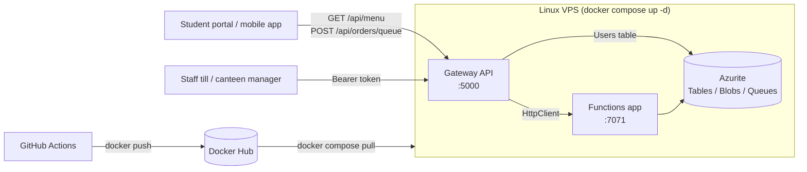

# CoffeeNChill — Canteen Management System

**Part 3 (POE) — Web API Gateway, JWT Authentication & VPS Deployment**

CoffeeNChill is a campus canteen. Part 1 replaced the paper menus and filing-cabinet documents with Azure Table Storage, Azure Blob Storage and HTTP-triggered Azure Functions. Part 2 added the order queue, queue-triggered processing and Docker Compose. Part 3 adds:

- An **ASP.NET Core Web API gateway** (`CoffeeNChillGatewayAPI`) that routes client requests to the Azure Functions using DTOs.
- **JWT authentication** with user profiles stored in a **Users** Azure Table and passwords hashed with **BCrypt**.
- **Role-based access**: anyone can view the menu and place orders. Only **Admin** and **Staff** users can change the menu, manage staff documents and update order statuses.
- **Swagger UI** with XML documentation for the endpoints, request bodies and response codes.
- **Global exception middleware** so every error is returned in the same format.
- **Deployment to a Linux VPS** with Docker Compose, pulling the images from Docker Hub.
- A **GitHub Actions pipeline** (bonus) that builds, tests, pushes the images and redeploys the VPS on every push to `main`.

> **Live gateway:** https://kay-interface-memorabilia-circular.trycloudflare.com/swagger — _public access is closed after the video recording._

---

## Architecture



1. The client calls the gateway. Protected routes need `Authorization: Bearer <token>`.
2. The gateway checks the token and the user's role, then calls the matching Azure Function through a typed `HttpClient` (`MenuFunctionClient`, `DocumentFunctionClient`, `OrderFunctionClient`).
3. Register and login go straight to the `Users` table with the Azure Tables SDK.
4. A missing or invalid token returns `401 Unauthorized`. A valid token without the right role returns `403 Forbidden`.

---

## Project structure

```
CoffeeNChill/
├── .github/workflows/deploy.yml
├── CoffeeNChill.slnx
├── docker-compose.yml
├── README.md
├── docs/
│   ├── CoffeeNChill.postman_collection.json
│   ├── CoffeeNChill-Part2-Functions.postman_collection.json
│   └── sample-recipe.pdf
├── CoffeeNChillExample/                 Azure Functions app (v3.0)
│   ├── Dockerfile
│   ├── Functions/   (incl. new DeleteStaffDocument.cs and UpdateOrderStatus.cs)
│   ├── Models/      (incl. new OrderStatusUpdate.cs)
│   └── Services/
├── CoffeeNChillGatewayAPI/              ASP.NET Core Web API gateway
│   ├── Dockerfile
│   ├── Program.cs
│   ├── appsettings.json
│   ├── Clients/      MenuFunctionClient, DocumentFunctionClient, OrderFunctionClient
│   ├── Controllers/  AuthController, MenuController, DocumentController, OrderController
│   ├── DTOs/         AuthDtos, MenuDtos, OrderDtos, DocumentDtos, ErrorResponseDto
│   ├── Middleware/   GlobalExceptionMiddleware
│   ├── Models/       UserEntity
│   └── Services/     AuthService, UserService
└── CoffeeNChillGatewayAPI.Tests/        unit tests run by the pipeline
```

---

## API Endpoints (Gateway)

Base URL: `http://localhost:5000/api` (or `https://kay-interface-memorabilia-circular.trycloudflare.com/api` live). Swagger is at `/swagger`.

| Method | Route | Access |
|---|---|---|
| POST | `/api/auth/register` | Anonymous |
| POST | `/api/auth/login` | Anonymous |
| GET | `/api/menu` | **Anonymous** |
| GET | `/api/menu/category/{category}` | Anonymous |
| POST | `/api/menu` | Admin, Staff |
| PUT | `/api/menu/{category}/{id}` | Admin, Staff |
| DELETE | `/api/menu/{category}/{id}` | Admin, Staff |
| POST | `/api/documents/upload` | Admin, Staff |
| GET | `/api/documents` | Admin, Staff |
| GET | `/api/documents/download/{fileName}` | Admin, Staff |
| DELETE | `/api/documents/{fileName}` | Admin, Staff |
| POST | `/api/orders/queue` | **Anonymous** |
| GET | `/api/orders` | Admin, Staff |
| GET | `/api/orders/{orderId}` | Admin, Staff |
| PUT | `/api/orders/status` | Admin, Staff |

### Users table

| Property | Value |
|---|---|
| PartitionKey | Role (`Admin`, `Staff` or `Customer`) |
| RowKey | Email, e.g. `barista@coffeenchill.ac.za` |
| PasswordHash | BCrypt hash of the password |
| FullName | String |
| CreatedDate | DateTime |

`POST /api/auth/login` returns a token signed with HMAC-SHA256 that contains `ClaimTypes.Name`, `ClaimTypes.Email` and `ClaimTypes.Role`, and expires after 60 minutes.

### Error responses

Every error caught by `GlobalExceptionMiddleware` is returned as an `ErrorResponseDto`:

```json
{
    "StatusCode": 404,
    "Message": "The requested item was not found",
    "Detailed": "Response status code does not indicate success: 404 (Not Found).",
    "TimestampUtc": "2026-11-09T12:00:00Z"
}
```

`404`, `409`, `400` and `415` from the Functions app are passed through. If the Functions app can't be reached the gateway returns `502`, and anything else returns `500`.

---

## Running the whole stack with Docker Compose

From the repository root:

```bash
docker compose up -d
```

This pulls `coffeenchill-azurite:v1.0`, `coffeenchill-functions:v3.0` and `coffeenchill-gateway:v3.0` from Docker Hub.

| Service | URL |
|---|---|
| Gateway + Swagger | `http://localhost:5000/swagger` |
| Functions | `http://localhost:7071/api` |
| Azurite | ports `10000`, `10001`, `10002` |

```bash
docker compose down
```

## Running locally from Visual Studio

1. Start Azurite: `docker run -d --name azurite -p 10000:10000 -p 10001:10001 -p 10002:10002 mcr.microsoft.com/azure-storage/azurite`
2. Open `CoffeeNChill.slnx`, right-click the solution → **Configure Startup Projects** → **Multiple startup projects**, and start both `CoffeeNChill` and `CoffeeNChillGatewayAPI`.
3. Press `F5`. Swagger opens on `http://localhost:5000/swagger`.

### Using Swagger with a token

1. **POST /api/auth/register** a user with the role `Admin` or `Staff`.
2. **POST /api/auth/login** and copy the `token` value.
3. Click **Authorize**, paste the token and click **Authorize** again. Swagger now sends it with every request.

## Docker Hub images

```bash
docker build -t liyemamncoraemecpe/coffeenchill-functions:v3.0 ./CoffeeNChillExample
docker build -t liyemamncoraemecpe/coffeenchill-gateway:v3.0 ./CoffeeNChillGatewayAPI
docker push liyemamncoraemecpe/coffeenchill-functions:v3.0
docker push liyemamncoraemecpe/coffeenchill-gateway:v3.0
```

- Gateway: `https://hub.docker.com/r/liyemamncoraemecpe/coffeenchill-gateway`
- Functions: `https://hub.docker.com/r/liyemamncoraemecpe/coffeenchill-functions`
- Azurite: `https://hub.docker.com/r/liyemamncoraemecpe/coffeenchill-azurite`

---

## Live deployment

No cloud credits were available, so the stack is hosted on a team member's machine (one of the brief's "Linux box" options) running Docker Linux containers, and made public with a Cloudflare quick tunnel (Docker Inc., 2026d; Cloudflare, 2026).

1. Install Docker Desktop with the Compose plugin.
2. Pull the images from Docker Hub and start the stack from the repo folder:

   ```bash
   docker compose pull
   docker compose up -d
   ```

3. Open the public tunnel to the gateway:

   ```bash
   cloudflared tunnel --url http://localhost:5000
   ```

4. Browse to the printed `https://<name>.trycloudflare.com/swagger` URL. The URL changes each time the tunnel starts, and public access is closed again after the video.

## CI/CD pipeline (bonus)

`.github/workflows/deploy.yml` runs on every push to `main`:

1. **build-and-test**: checks out the code, sets up .NET 10, builds the solution and runs the unit tests.
2. **docker**: logs in to Docker Hub, then builds and pushes `coffeenchill-functions:v3.0` and `coffeenchill-gateway:v3.0`.
3. **deploy**: SSHes into the VPS, copies `docker-compose.yml` across and runs `docker compose pull && docker compose up -d`.

Add these under **Settings → Secrets and variables → Actions**:

| Name | Type |
|---|---|
| `DOCKERHUB_USERNAME` | Variable |
| `DOCKERHUB_TOKEN` | Secret |
| `VPS_HOST` | Variable |
| `VPS_USER` | Variable |
| `VPS_SSH_KEY` | Secret |

The docker and deploy jobs are skipped until `DOCKERHUB_USERNAME` and `VPS_HOST` are set.

---

## Testing with Postman

1. Import `docs/CoffeeNChill.postman_collection.json`.
2. Set `baseUrl` to `http://localhost:5000/api` (or the VPS address).
3. Set the Postman working directory to the `docs` folder so the upload finds `sample-recipe.pdf`.
4. Run the folders in order.

| Folder | What it tests |
|---|---|
| **Authentication** | Registers an Admin, a Staff member and a Customer, rejects a duplicate, logs each one in (saving `adminToken`, `token` and `customerToken`), checks the Name, Email and Role claims, and rejects a wrong password |
| **Menu Items** | Anyone can view the menu. Creating an item returns `401` with no token, `403` with a Customer token and `201` with a Staff token. Then category filter, update, delete and `404` |
| **Staff Documents** | Upload returns `401` with no token and `200` with a Staff token. Listing returns `403` for a Customer. Then list, download and delete |
| **Orders** | Anyone can place an order (`202`), an invalid order returns `400`, the order is logged by the queue trigger, a Customer cannot update the status (`403`), Staff can (`200`), and the order shows in the list |

Protected requests send `Bearer {{token}}` (Postman Inc., 2026b). `docs/CoffeeNChill-Part2-Functions.postman_collection.json` still tests the Functions app directly on port `7071`.

---

## Changelog

### v3.0 — Part 3: Web API Gateway, JWT Authentication & VPS Deployment

**Added**
- `CoffeeNChillGatewayAPI` with `AuthController`, `MenuController`, `DocumentController` and `OrderController`, plus typed `HttpClient`s that call the Functions app.
- DTOs for the menu, orders, documents, auth and errors, with data-annotation validation.
- `UserService` (Users table) and `AuthService` (BCrypt hashing and JWT tokens with the Name, Email and Role claims).
- `[Authorize(Roles = "Admin,Staff")]` on the protected routes and `[AllowAnonymous]` on `GET /api/menu` and `POST /api/orders/queue`.
- `GlobalExceptionMiddleware` and `ErrorResponseDto`.
- Swagger UI with XML documentation and the Bearer security scheme.
- Functions: `DeleteStaffDocument` (`DELETE /api/documents/{fileName}`) and `UpdateOrderStatus` (`PUT /api/orders/status`).
- Gateway `Dockerfile`, a `gateway` service in `docker-compose.yml`, unit tests and the GitHub Actions pipeline.
- Part 3 Postman collection with Bearer token requests.

**Changed**
- `docker-compose.yml` now uses `coffeenchill-functions:v3.0` and `coffeenchill-gateway:v3.0`.
- `CreateMenuItem` returns `409 Conflict` for a duplicate item instead of `500`.
- Uploading a document with a name that already exists returns `409` instead of overwriting it.
- The Part 2 Postman collection was renamed to `CoffeeNChill-Part2-Functions.postman_collection.json`.

### v2.0 — Part 2: Queue Triggers & Docker Compose

**Added**
- `QueueOrder` (`POST /api/orders/queue`): validates the order, generates `OrderId` and `OrderTimestamp` when missing, serializes it to JSON and places it on `order-processing-queue` using Base64 encoding. Returns `202`, `400`, `503` or `500`.
- `ProcessOrderQueue`: queue trigger that parses the message and writes it to the `Orders` table with status `Received`. Errors are logged and rethrown so the host retries and then poisons the message.
- `AdvanceOrderStatus`: timer trigger (every 5 seconds) that moves orders `Received` → `Preparing` → `Ready` → `Collected`.
- `ProcessPoisonOrderQueue`: queue trigger on `order-processing-queue-poison` that records failed messages in the `FailedOrders` table.
- `GetAllOrders`, `GetOrderById` and `GetFailedOrders` so order status and failures can be checked from Postman.
- `OrderQueueMessage`, `OrderEntity` and `FailedOrderEntity` models and `QueueService`, `OrderService` and `FailedOrderService` services.
- `docker-compose.yml`: Azurite and the Functions app from Docker Hub images (`coffeenchill-azurite:v1.0`, `coffeenchill-functions:v2.0`), a custom bridge network and a volume for Azurite data.
- Queue settings in `host.json` (2 second polling, 3 attempts before poison, Base64 messages).
- Postman collection updated with an **Orders** folder covering every new function.

**Changed**
- The storage services are now created once at startup in `Program.cs` from the `AzureWebJobsStorage` setting instead of using a hard-coded `UseDevelopmentStorage=true` in every function. The same code now runs from Visual Studio and from Docker Compose, where Azurite is reached at `azurite` instead of `localhost`.
- The existing menu and document functions receive their service through constructor injection.
- The menu table is named `MenuItems` to match the brief (it was `Menuitems`).
- `CoffeeNChill.slnx` points at `CoffeeNChillExample/CoffeeNChill.csproj`, and the empty `CoffeeNChill/` project was removed.
- Added `Azure.Storage.Queues`, `Microsoft.Azure.Functions.Worker.Extensions.Storage.Queues` and `Microsoft.Azure.Functions.Worker.Extensions.Timer`.

**Fixed**
- Removed the inline comment on the Dockerfile `FROM` line, which Docker reads as extra arguments.
- Corrected the Docker Hub image names in the push commands.

### v1.0 — Part 1: Azure Functions, Tables, Blob Storage & Docker Hub

- Menu item CRUD functions on Azure Table Storage.
- Staff document upload, list and download functions on Azure Blob Storage.
- Azurite in Docker, Dockerfile for the Functions app and the Postman collection for Part 1.

---

## Team Contributions

### Part 1

| Member | Student Number | Contribution |
|---|---|---|
| Jake Jacobs | st10477406 | Set up the functions that let users add, view, update and delete menu items using Table Storage, made the menu and staff document models, and built the code that connects to Table Storage. Also got file uploads for staff documents working, using Azure File Shares. |
| Liyema Mncora | st10397155 | Swapped the file storage over to Azure Blob Storage like the brief asked for, fixed the file upload code so it properly handles real file uploads instead of just a filename trick and made the storage setup safer by loading it properly instead of blocking the app while it starts. |

### Part 2

| Member | Student Number | Contribution |
|---|---|---|
| Jake Jacobs | st10477406 | Built the first version of the order flow: the function that checks an order and puts it on the order-processing queue, and the queue-triggered function that saves each order to the Orders table and moves it through Received, Preparing, Ready and Collected. Made the order models and the services that connect to Queue Storage and the Orders table, added the function that returns all orders, and set up the queue settings in host.json and the multi-stage Dockerfile so the app builds and runs in a container. |
| Liyema Mncora | st10397155 | Reworked the order flow into the final version by creating the storage services once at startup in Program.cs and injecting them into every function, so the same code runs from Visual Studio and from Docker Compose. Added the timer-triggered function that moves orders through each status, the poison queue function that saves failed messages to the FailedOrders table, and the functions to get an order by ID and to view failed orders. Wrote the docker-compose.yml that runs Azurite and the Functions app from the Docker Hub images, built the Orders folder in the Postman collection and updated the README. |

### Part 3

| Member | Student Number | Contribution |
|---|---|---|
| Jake Jacobs | st10477406 | Set up the gateway project and built the login side of it: the Users table entity and the service that connects to it, the register and login endpoints with their DTOs, hashing passwords with BCrypt before they are saved, and creating the JWT with the user's name, email and role. Set up JWT bearer authentication and Swagger in Program.cs, with XML comments and the Authorize button so a token can be tested straight from Swagger, wrote the unit tests for the tokens and password hashing, and made the multi-stage Dockerfile for the gateway. |
| Liyema Mncora | st10397155 | Built the rest of the gateway on top of the login: the menu, document and order controllers and DTOs, the typed HttpClients that call the Functions app, the Admin/Staff roles on each protected route and the global exception middleware that returns the same error format every time. Added the DeleteStaffDocument and UpdateOrderStatus functions and stopped duplicate document uploads overwriting files. Added the gateway to docker-compose.yml, pushed the v3.0 images to Docker Hub, wrote the GitHub Actions pipeline, made the Part 3 Postman collection with the Bearer token flows, deployed the stack live through a Cloudflare tunnel and updated the README. |

## Video Demonstration

- Part 1: [Youtube Demo](https://youtu.be/oURz118OSBA)
- Part 2: [Youtube Demo](https://youtu.be/roun1GQfg7k)
- Part 3: _Add the unlisted YouTube link here._

## References

Microsoft (2026a) _Azure Functions documentation_. Available at: https://learn.microsoft.com/en-us/azure/azure-functions/ (Accessed: 13 September 2026).

Microsoft (2026b) _Guide for running C# Azure Functions in the isolated worker model_. Available at: https://learn.microsoft.com/en-us/azure/azure-functions/dotnet-isolated-process-guide (Accessed: 13 September 2026).

Microsoft (2026c) _Azure Functions HTTP trigger_. Available at: https://learn.microsoft.com/en-us/azure/azure-functions/functions-bindings-http-webhook-trigger (Accessed: 13 September 2026).

Microsoft (2026d) _What is Azure Table storage?_. Available at: https://learn.microsoft.com/en-us/azure/storage/tables/table-storage-overview (Accessed: 13 September 2026).

Microsoft (2026e) _Azure Blob storage documentation_. Available at: https://learn.microsoft.com/en-us/azure/storage/blobs/ (Accessed: 13 September 2026).

Microsoft (2026f) _Use Azurite emulator for local Azure Storage development_. Available at: https://learn.microsoft.com/en-us/azure/storage/common/storage-use-azurite (Accessed: 13 September 2026).

Microsoft (2026g) _Azure Tables client library for .NET - version 12.12.0_. Available at: https://learn.microsoft.com/en-us/dotnet/api/overview/azure/data.tables-readme (Accessed: 13 September 2026).

Microsoft (2026h) _Azure Storage Blobs client library for .NET - version 12.29.2_. Available at: https://learn.microsoft.com/en-us/dotnet/api/overview/azure/storage.blobs-readme (Accessed: 13 September 2026).

Microsoft (2026i) _Upload files in ASP.NET Core_. Available at: https://learn.microsoft.com/en-us/aspnet/core/mvc/models/file-uploads (Accessed: 13 September 2026).

W3Schools (2026a) _C# Files_. Available at: https://www.w3schools.com/cs/cs_files.php (Accessed: 13 September 2026).

W3Schools (2026b) _JavaScript JSON_. Available at: https://www.w3schools.com/js/js_json.asp (Accessed: 13 September 2026).

Docker Inc. (2026a) _Docker Manuals_. Available at: https://docs.docker.com/manuals/ (Accessed: 13 September 2026).

Postman Inc. (2026a) _Get started in Postman_. Available at: https://learning.postman.com/docs/getting-started/overview/ (Accessed: 13 September 2026).

Microsoft (2026j) TableClient.UpdateEntity<T> Method (Azure.Data.Tables). Available at: https://learn.microsoft.com/en-us/dotnet/api/azure.data.tables.tableclient.updateentity (Accessed: 14 September 2026).

Microsoft (2026k) BlobBaseClient.DownloadStreamingAsync Method (Azure.Storage.Blobs). Available at: https://learn.microsoft.com/en-us/dotnet/api/azure.storage.blobs.specialized.blobbaseclient.downloadstreamingasync (Accessed: 14 September 2026).

Microsoft (2026l) Differences between the isolated worker model and the in-process model for .NET on Azure Functions. Available at: https://learn.microsoft.com/en-us/azure/azure-functions/dotnet-isolated-in-process-differences (Accessed: 14 September 2026).

Microsoft (2026m) Use OpenTelemetry with Azure Functions. Available at: https://learn.microsoft.com/en-us/azure/azure-functions/opentelemetry-howto (Accessed: 14 September 2026).

Mrzyglod, K. (2022) Azure for Developers: Implement rich Azure PaaS ecosystems using containers, serverless services, and storage solutions. 2nd edn. Birmingham: Packt Publishing. ISBN: 9781803240091.

Huawei (2022) Cloud Computing Technology. Singapore: Springer. ISBN: 978-981-19-3025-6. Available at: https://link.springer.com/book/10.1007/978-981-19-3026-3 (Accessed: 12 September 2026).

IIE (2026) Cloud Development B: Lecture notes distributed in CLDV6212 Learning Unit 1. Available at: https://mystudies.iie.edu.za/d2l/le/lessons/81852/units/5622998 (Accessed: 14 September 2026).

IIE (2026) Cloud Development B: Lecture notes distributed in CLDV6212 Learning Unit 2. Available at: https://mystudies.iie.edu.za/d2l/le/lessons/81852/units/5622999 (Accessed: 14 September 2026).

IIE (2026) Cloud Development B: Lecture notes distributed in CLDV6212 Learning Unit 3. Available at: https://mystudies.iie.edu.za/d2l/le/lessons/81852/units/5623000 (Accessed: 14 September 2026).

IIE (2026) Cloud Development B: Lecture notes distributed in CLDV6212 Learning Unit 4. Available at: https://mystudies.iie.edu.za/d2l/le/lessons/81852/units/5623001 (Accessed: 12 October 2026).

IIE (2026) Cloud Development B: Lecture notes distributed in CLDV6212 Learning Unit 5. Available at: https://mystudies.iie.edu.za/d2l/le/lessons/81852/units/5623002 (Accessed: 12 October 2026).

IIE (2026) Cloud Development B: Lecture notes distributed in CLDV6212 Learning Unit 6. Available at: https://mystudies.iie.edu.za/d2l/le/lessons/81852/units/5623003 (Accessed: 12 October 2026).

IIE (2026) Cloud Development B: Lecture notes distributed in CLDV6212 Learning Unit 7. Available at: https://mystudies.iie.edu.za/d2l/le/lessons/81852/units/5623004 (Accessed: 12 October 2026).

rudderz243 (2026) cldv6212-Class-Repo. Available at: https://github.com/rudderz243/cldv6212-Class-Repo (Accessed: 9 November 2026).

Microsoft (2026n) What is Azure Queue Storage?. Available at: https://learn.microsoft.com/en-us/azure/storage/queues/storage-queues-introduction (Accessed: 12 October 2026).

Microsoft (2026o) Azure Storage Queues client library for .NET - version 12.28.1. Available at: https://learn.microsoft.com/en-us/dotnet/api/overview/azure/storage.queues-readme (Accessed: 12 October 2026).

Microsoft (2026p) Azure Queue storage trigger for Azure Functions. Available at: https://learn.microsoft.com/en-us/azure/azure-functions/functions-bindings-storage-queue-trigger (Accessed: 12 October 2026).

Microsoft (2026q) Azure Queue storage trigger and bindings for Azure Functions overview. Available at: https://learn.microsoft.com/en-us/azure/azure-functions/functions-bindings-storage-queue (Accessed: 12 October 2026).

Microsoft (2026r) Timer trigger for Azure Functions. Available at: https://learn.microsoft.com/en-us/azure/azure-functions/functions-bindings-timer (Accessed: 12 October 2026).

Microsoft (2026s) Queue-Based Load Leveling pattern. Available at: https://learn.microsoft.com/en-us/azure/architecture/patterns/queue-based-load-leveling (Accessed: 12 October 2026).

Microsoft (2026t) Get started with Storage Explorer. Available at: https://learn.microsoft.com/en-us/azure/storage/storage-explorer/vs-azure-tools-storage-manage-with-storage-explorer (Accessed: 12 October 2026).

Docker Inc. (2026b) Docker Compose. Available at: https://docs.docker.com/compose/ (Accessed: 12 October 2026).

Docker Inc. (2026c) Networking in Compose. Available at: https://docs.docker.com/compose/how-tos/networking/ (Accessed: 12 October 2026).

Microsoft (2026u) _Create web APIs with ASP.NET Core_. Available at: https://learn.microsoft.com/en-us/aspnet/core/web-api/ (Accessed: 9 November 2026).

Microsoft (2026v) _Get started with Swashbuckle and ASP.NET Core_. Available at: https://learn.microsoft.com/en-us/aspnet/core/tutorials/getting-started-with-swashbuckle (Accessed: 9 November 2026).

Microsoft (2026w) _Configure JWT bearer authentication in ASP.NET Core_. Available at: https://learn.microsoft.com/en-us/aspnet/core/security/authentication/configure-jwt-bearer-authentication (Accessed: 9 November 2026).

Microsoft (2026x) _Role-based authorization in ASP.NET Core_. Available at: https://learn.microsoft.com/en-us/aspnet/core/security/authorization/roles (Accessed: 9 November 2026).

Microsoft (2026y) _Write custom ASP.NET Core middleware_. Available at: https://learn.microsoft.com/en-us/aspnet/core/fundamentals/middleware/write (Accessed: 9 November 2026).

Microsoft (2026z) _Handle errors in ASP.NET Core APIs_. Available at: https://learn.microsoft.com/en-us/aspnet/core/web-api/handle-errors (Accessed: 9 November 2026).

Microsoft (2026aa) _HTTP requests with IHttpClientFactory - ASP.NET Core_. Available at: https://learn.microsoft.com/en-us/aspnet/core/fundamentals/http-requests (Accessed: 9 November 2026).

Microsoft (2026ab) _Create Data Transfer Objects (DTOs)_. Available at: https://learn.microsoft.com/en-us/aspnet/web-api/overview/data/using-web-api-with-entity-framework/part-5 (Accessed: 9 November 2026).

Microsoft (2026ac) _Model validation in ASP.NET Core MVC_. Available at: https://learn.microsoft.com/en-us/aspnet/core/mvc/models/validation (Accessed: 9 November 2026).

Microsoft (2026ad) _Unit testing C# code in .NET using dotnet test and xUnit_. Available at: https://learn.microsoft.com/en-us/dotnet/core/testing/unit-testing-csharp-with-xunit (Accessed: 9 November 2026).

Microsoft (2026ae) _JwtSecurityTokenHandler Class (System.IdentityModel.Tokens.Jwt)_. Available at: https://learn.microsoft.com/en-us/dotnet/api/system.identitymodel.tokens.jwt.jwtsecuritytokenhandler (Accessed: 9 November 2026).

Microsoft (2026af) _Hash passwords in ASP.NET Core_. Available at: https://learn.microsoft.com/en-us/aspnet/core/security/data-protection/consumer-apis/password-hashing (Accessed: 9 November 2026).

Microsoft (2026ag) _Run an ASP.NET Core app in Docker containers_. Available at: https://learn.microsoft.com/en-us/aspnet/core/host-and-deploy/docker/building-net-docker-images (Accessed: 9 November 2026).

Microsoft (2026ah) _Gateway Routing pattern_. Available at: https://learn.microsoft.com/en-us/azure/architecture/patterns/gateway-routing (Accessed: 9 November 2026).

Microsoft (2026ai) _BlobBaseClient.DeleteIfExistsAsync Method (Azure.Storage.Blobs.Specialized)_. Available at: https://learn.microsoft.com/en-us/dotnet/api/azure.storage.blobs.specialized.blobbaseclient.deleteifexistsasync (Accessed: 9 November 2026).

Microsoft (2026aj) _XML API documentation comments - document APIs using /// comments_. Available at: https://learn.microsoft.com/en-us/dotnet/csharp/language-reference/xmldoc/ (Accessed: 9 November 2026).

Microsoft (2026ak) _Manage concurrency in Blob Storage_. Available at: https://learn.microsoft.com/en-us/azure/storage/blobs/concurrency-manage (Accessed: 9 November 2026).

Microsoft (2026al) _Connect to a Linux VM_. Available at: https://learn.microsoft.com/en-us/azure/virtual-machines/linux-vm-connect (Accessed: 9 November 2026).

Microsoft (2026am) _Configuration in ASP.NET Core_. Available at: https://learn.microsoft.com/en-us/aspnet/core/fundamentals/configuration/ (Accessed: 9 November 2026).

W3Schools (2026c) _C# Properties (Get and Set)_. Available at: https://www.w3schools.com/cs/cs_properties.php (Accessed: 9 November 2026).

W3Schools (2026d) _C# Exceptions - Try..Catch_. Available at: https://www.w3schools.com/cs/cs_exceptions.php (Accessed: 9 November 2026).

W3Schools (2026e) _HTTP Status Codes_. Available at: https://www.w3schools.com/tags/ref_httpmessages.asp (Accessed: 9 November 2026).

W3Schools (2026f) _C# Inheritance_. Available at: https://www.w3schools.com/cs/cs_inheritance.php (Accessed: 9 November 2026).

Docker Inc. (2026d) _Install Docker Desktop on Windows_. Available at: https://docs.docker.com/desktop/setup/install/windows-install/ (Accessed: 9 November 2026).

GitHub (2026a) _Workflow syntax for GitHub Actions_. Available at: https://docs.github.com/en/actions/reference/workflows-and-actions/workflow-syntax (Accessed: 9 November 2026).

GitHub (2026b) _Using secrets in GitHub Actions_. Available at: https://docs.github.com/en/actions/how-tos/write-workflows/choose-what-workflows-do/use-secrets (Accessed: 9 November 2026).

GitHub (2026c) _Store information in variables_. Available at: https://docs.github.com/en/actions/how-tos/write-workflows/choose-what-workflows-do/use-variables (Accessed: 9 November 2026).

Postman Inc. (2026b) _Authorization types supported by Postman_. Available at: https://learning.postman.com/docs/sending-requests/authorization/authorization-types/ (Accessed: 9 November 2026).

Cloudflare (2026) _Quick Tunnels_. Available at: https://developers.cloudflare.com/tunnel/get-started/quick-tunnels/ (Accessed: 9 November 2026).
